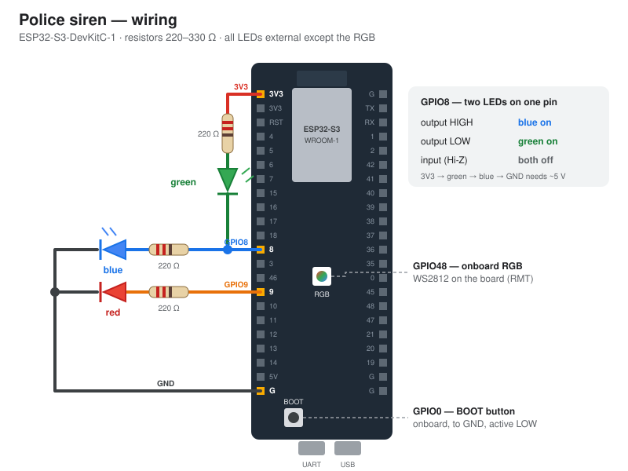

# 🧰 Claude Code skills for ESP32 projects

Reusable [Claude Code](https://claude.com/claude-code) skills from Beetroot Academy embedded lessons. Install once, then use them in any of your projects.

| Plugin | What it does |
|---|---|
| [`wiring-docs`](plugins/wiring-docs/skills/wiring-docs/SKILL.md) | Reads the pins from your code and makes **a wiring picture for the README** (`docs/wiring.svg`) and **a Wokwi simulator project** (`diagram.json`, `wokwi.toml`). It saves the project on wokwi.com, tests it with your own firmware and adds a "Simulate" badge to the README. |

Example result: [Lesson 1.3 — Police siren](https://github.com/eoffers51/Lesson_1_3_Blink#-wiring) · [its Wokwi project](https://wokwi.com/projects/477673393523940353)



## 📦 Install

In Claude Code (any project):

```text
/plugin marketplace add eoffers51/claude-skills
/plugin install wiring-docs@beetroot-esp32
```

Update later with `/plugin marketplace update beetroot-esp32`.

<details>
<summary>Without the plugin system (copy the folder)</summary>

```bash
git clone https://github.com/eoffers51/claude-skills
# for all your projects:
cp -r claude-skills/plugins/wiring-docs/skills/wiring-docs ~/.claude/skills/
# or only for one project:
cp -r claude-skills/plugins/wiring-docs/skills/wiring-docs <your-project>/.claude/skills/
```

</details>

## ▶️ Use

Open your project in Claude Code and ask, for example:

> Add an accurate wiring diagram to the README and a Wokwi simulator link for this project

or call it directly: `/wiring-docs`.

Claude will:
1. read the pins from your code and ask about the things the code can't show (resistor values, LED polarity, which parts are on the board);
2. show you a wiring table to confirm;
3. draw `docs/wiring.svg` and make `diagram.json` + `wokwi.toml`;
4. (if you have [Claude in Chrome](https://claude.com/chrome) and are signed in to [wokwi.com](https://wokwi.com)) build the circuit on wokwi.com, upload your firmware, test every mode, and **ask you** before saving it (free plan = public project);
5. update the README.

### Requirements

- Claude Code
- Git Bash on Windows (or any bash on macOS/Linux), `curl`, Python 3, and Chrome or Edge (used to check the SVG picture)
- For the online simulator: a free [wokwi.com](https://wokwi.com) account and the Claude in Chrome extension
- ESP-IDF projects: `idf.py build merge-bin` (or a CI build) to get the firmware `.bin`

## 🗂️ Layout

```text
.claude-plugin/marketplace.json        marketplace "beetroot-esp32"
plugins/<plugin>/.claude-plugin/plugin.json
plugins/<plugin>/skills/<skill>/SKILL.md   the instructions Claude follows
                         reference/        details loaded only when needed
                         templates/        example files to start from
                         scripts/          helper scripts
```

To add a skill: create `plugins/<name>/` the same way, add it to `marketplace.json`, bump the versions, and check with `claude plugin validate .`.

## License

MIT
